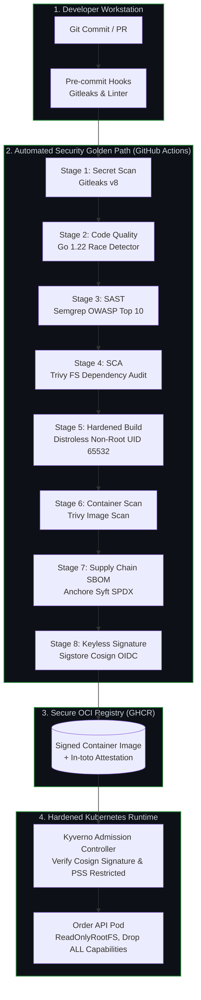

# Enterprise DevSecOps Pipeline (The Golden Path)

[](https://github.com/huy8114644/enterprise-devsecops-pipeline/actions/workflows/devsecops-pipeline.yml)
[](https://opensource.org/licenses/MIT)
[](https://slsa.dev)
[](https://github.com/GoogleContainerTools/distroless)
[](https://go.dev)

Production-grade **Reusable DevSecOps CI/CD Golden Path Pipeline** implementing true Shift-Left security, automated supply-chain verification (SLSA Level 3), and native GitHub Security Code Scanning integration.

---

## 🎯 Problem Statement & Core Value

Modern software delivery often suffers from "security as a bottleneck" — vulnerabilities, hardcoded secrets, and compliance violations are only uncovered late in the deployment cycle or during annual audits.

This project delivers an enterprise-ready **Security Golden Path**:
1. **Shift-Left Detection:** Prevent secret leaks (Gitleaks) and code vulnerabilities (Semgrep SAST) before merging.
2. **Software Supply Chain Integrity:** Produce reproducible multi-stage Distroless containers with cryptographically signed in-toto attestations (Cosign OIDC) and machine-readable SBOMs (Syft SPDX).
3. **Zero-Trust Runtime Hardening:** Enforce Kubernetes Pod Security Standards (PSS) Restricted at admission time via Kyverno.

---

## 🏛️ Pipeline Security Architecture



---

## 🔒 Security Capabilities & Tooling

| Stage | Tool | Enforcement Policy | Output / Verification |
|---|---|---|---|
| **Secret Scanning** | Gitleaks v8 | Block unencrypted credentials, API tokens, and private keys | Build failure, SARIF upload |
| **SAST** | Semgrep | AST inspection detecting injection flaws, SSRF, insecure TLS | Native GitHub Code Scanning alerts |
| **SCA** | Trivy FS | Evaluate transitive dependencies against NVD, OSV, GHSA | Automated CVE report with gate thresholds |
| **Hardened Image** | Docker + Distroless | No package manager, no shell (`/bin/sh`), UID 65532 | Zero attack surface for shell breakouts |
| **Image Scan** | Trivy Image | Scan base OS layers and compiled Go binaries | Block deployment on CRITICAL CVEs |
| **SBOM** | Anchore Syft | Generate full software bill of materials | SPDX / CycloneDX JSON artifacts |
| **Cosign Signing** | Sigstore Cosign | Keyless cryptographic container signing using GitHub OIDC | Verifiable via Kyverno admission policies |

---

## ⚙️ Environment Variables & Configuration

The microservice (`services/order-api`) is configured via standard environment variables:

| Variable | Type | Default | Description |
|---|---|---|---|
| `PORT` | Integer | `8080` | TCP port on which the HTTP server listens |
| `LOG_LEVEL` | String | `info` | Logging verbosity (`debug`, `info`, `warn`, `error`) |
| `RATE_LIMIT_RPS` | Float | `100.0` | Token bucket rate limit (requests per second per client IP) |
| `RATE_LIMIT_BURST` | Integer | `200` | Token bucket burst capacity |
| `ENVIRONMENT` | String | `production` | Deployment environment (`development`, `staging`, `production`) |
| `CORS_ALLOWED_ORIGINS` | String | `*` | Comma-separated list of allowed CORS origins |

---

## 🚀 Local Developer Quickstart

Standardized developer commands are managed via the included `Makefile`:

```bash
# 1. Inspect all available targets
make help

# 2. Run Go static code analysis
make lint

# 3. Execute unit tests with race detection
make test

# 4. Run the full security scan suite (Secrets, SAST, SCA)
make scan

# 5. Build the hardened Distroless container image
make build

# 6. Run the microservice locally
make run-local
# Test health endpoint: curl http://localhost:8080/healthz
# Test security headers: curl -I http://localhost:8080/api/v1/orders
```

---

## ☸️ Production Kubernetes Deployment

The service is pre-configured with Kubernetes manifests enforcing **Pod Security Standards (PSS) Restricted**:

```bash
# Deploy to Kubernetes cluster
kubectl apply -f k8s/service.yaml
kubectl apply -f k8s/deployment.yaml

# Verify non-root execution and securityContext
kubectl get pods -l app=order-api -o jsonpath='{.items[0].spec.securityContext}'
```

Key security attributes in `k8s/deployment.yaml`:
- `runAsNonRoot: true` (UID 65532).
- `readOnlyRootFilesystem: true` (prevents malicious in-pod filesystem tampering).
- `allowPrivilegeEscalation: false`.
- `capabilities.drop: ["ALL"]` (removes all Linux kernel capabilities).
- `seccompProfile.type: "RuntimeDefault"`.

---

## 📄 License
This project is licensed under the MIT License - see the [LICENSE](LICENSE) file for details.
