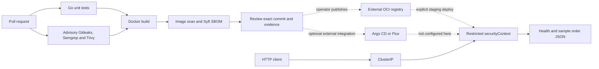

# Enterprise DevSecOps Pipeline

[](https://github.com/huy8114644/enterprise-devsecops-pipeline/actions/workflows/devsecops-pipeline.yml)

A Go HTTP service and security CI lab for reviewing secrets, code, dependencies and container inventory before delivery. It demonstrates repeatable security checks; it is not SLSA certification or a deployed commerce platform.

## Architecture and delivery



CI builds a local image. Publication, Cosign signing and GitOps reconciliation are external steps, not supplied automation. Distroless reduces installed tools; it does not eliminate attack surface.

The current CI job runs `go test -v ./...`, with neither an explicit `go vet` command nor `-race`. Gitleaks and Semgrep suppress command failures with `|| true`; Trivy findings are advisory, and the container scan explicitly uses exit code 0. A green run therefore does not establish clean security scans. Local Make targets have different failure behavior and must be assessed separately.

The separate scheduled `daily-cve-sync.yml` workflow still writes fixed vulnerability counts and a compliance label, then commits that digest to `main`. Those fields are not derived from its Trivy JSON and are not evidence of CVE remediation or SLSA compliance.

## Structure and configuration

| Path | Purpose |
|---|---|
| `services/order-api/` | Go module, handlers, middleware examples, tests, Dockerfile |
| `security/` | Gitleaks config and custom Semgrep rules |
| `k8s/` | Deployment and Service in namespace `production` |
| `.github/workflows/` | CI and scheduled scanner execution |

| Setting | Default | Actual behavior |
|---|---|---|
| `PORT` (runtime env) | `8080` | HTTP listener; manifests/probes assume 8080 |
| `IMAGE` (Make) | `order-api:local` | Build/run image |
| `GO` (Make) | `go` | Go executable |
| `CONTEXT` (Make) | required for plan | Explicit staging kubeconfig context |

There are no log-level, CORS or rate-limit environment settings. Middleware examples exist but `main.go` currently attaches the mux directly. Orders are synthetic; there is no database or authentication. Supply a reviewed TLS/auth gateway before external exposure.

## Local quickstart

Requires Make, Go 1.22+ and Docker. Scans also need Gitleaks v8, Semgrep, Trivy and advisory database access. Missing tools and findings fail the command.

```bash
make help
make lint test
# Go alternative if unavailable locally:
docker run --rm -v "$PWD/services/order-api:/app" -w /app golang:1.22 go test -race ./...
make scan
make build
make run-local
# In another terminal:
curl --fail http://127.0.0.1:8080/healthz
curl --fail http://127.0.0.1:8080/api/v1/orders
```

`make sbom` inventories `IMAGE`. Tests report coverage without a percentage gate. Legacy JSON digests in `security/reports/` have fixed counts and are not scanner evidence; use raw artifacts for the tested SHA.

## Plan, deploy and rollback

`make plan CONTEXT=staging` performs server-side dry-run only. It needs an existing cluster and `production` namespace. The GHCR tag in the example manifest is illustrative: publish your image, replace it with an immutable digest, then review the manifest diff.

```bash
make plan CONTEXT=staging
# Explicit operator action after review:
kubectl --context staging apply -f k8s/
kubectl --context staging -n production rollout status deployment/order-api
```

Verify health/readiness and connectivity. Roll back to previously reviewed image digests/manifests and check rollout again. Registry access, TLS, secrets and cluster controllers are managed separately.

## Review workflow

See [CONTRIBUTING.md](CONTRIBUTING.md). Use Conventional Commits and include the use case, changed behavior, rollout/rollback, tested SHA and CI link. A green badge for another commit is not evidence for a change. License: [MIT](LICENSE).
